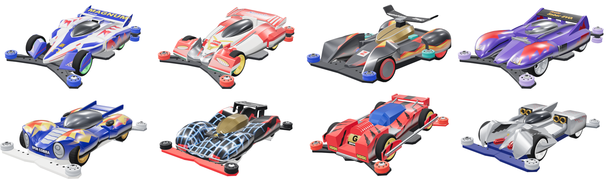
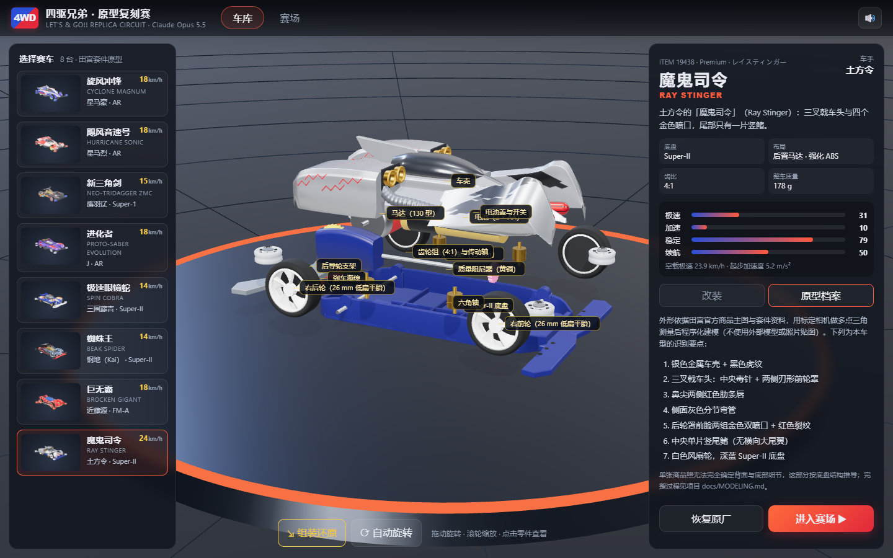

<!-- modelbenchlab-access -->
统一访问：在仓库根目录运行 `npm run dev`，打开 `http://localhost:3000/claudeopus5.5-mini4wd-replica/`。
独立调试：根目录运行 `npm run dev:one -- claudeopus5.5-mini4wd-replica`，打开 `http://localhost:3058/`。下文子目录启动说明仅用于独立开发。

# 四驱兄弟 · 原型复刻赛（Claude Opus 5.5）

以仓库中 `gpt6-mini4wd-room-racing`（mission `mini4wd`）为参照新建的 Opus 5.5 版本。用户的重点要求是**车的建模必须接近《四驱兄弟》原型**，因此本项目把主要工作放在八台车型的外形还原上：每台车都用田宫官方商品主图做相机标定，再三角测量关键点位，按点位程序化建模。Three.js 0.185.1 / WebGL 2 / Vite 8，零外部模型、零照片贴图，全部几何与涂装由代码生成。



## 车型

| 车型 | 原型（田宫套件） | 车手 | 底盘 | 辨识要点 |
| --- | --- | --- | --- | --- |
| 旋风冲锋 | Cyclone Magnum · ITEM 19440 | 星马豪 | AR | 独立蓝色楔形前轮罩、Y 形蓝鼻锥贴纸、高架蓝翼、荧光绿风扇轮 |
| 飓风音速号 | Hurricane Sonic · ITEM 19441 | 星马烈 | AR | 前轮罩间枪灰前翼、斜眼头灯、楔形侧舱三角网格、红底鸥翼 |
| 新三角剑 | Neo-Tridagger ZMC · ITEM 19409 | 鹰羽辽 | Super-1 | 三尖头、金棕多面座舱、单柱高架翼、侧置后导轮、前轮灰盘 |
| 进化者 | Proto-Saber Evolution · ITEM 19448 | J | AR | 紫壳银舱、鼓起前轮罩、高端板夹黑翼、Y 辐银轮 |
| 极速眼镜蛇 | Spin Cobra · ITEM 19450 | 三国藤吉 | Super-II | 圆宽金属蓝车身、镀铬椭圆头灯、银色鳞甲、双鳍翼、金色三辐轮 |
| 蜘蛛王 | Beak Spider · ITEM 19439 | 钢地（Kai） | Super-II | 黑壳蓝白蛛网、金色多面座舱、三层阶梯翼、红底盘白轮胎 |
| 巨无霸 | Brocken Gigant · ITEM 19452 | 近藤源 | FM-A | 前置马达肋片罩、G 徽标、夹轮外护板与银管架、蓝色多面座舱 |
| 魔鬼司令 | Ray Stinger · ITEM 19438 | 土方令 | Super-II | 三叉戟车头、红色肋条唇、金色四喷口、侧面分节弯管、单片竖鳍 |

每台车都可在车库的「原型档案」页查看识别要点。建模方法、标定精度与已知差异见 [docs/MODELING.md](docs/MODELING.md)。

## 玩法

- **车库**：选车、七槽改装（马达 / 齿轮比 / 轮胎 / 导轮 / 电池 / 刹车海绵 / 配重阻尼），改装件会在模型上体现（轮胎尺寸、导轮直径与颜色、刹车海绵、黄铜配重、马达标签、电池种类）。「拆解结构」把车壳、尾翼、底盘、马达、齿轮、电池、导轮、车轮等分开并标注，可点击零件查看名称。
- **赛场**：三条日本杯式赛道（基础 / 技术 / 高速），三种场馆（模型店 / 体育馆 / 夜间车库），3 或 5 车道、每圈经换道桥换一道。
- **两种模式**：
  - 竞技（真实规则）：比赛中不能操控，胜负完全取决于赛前调校。
  - 动画：按住 W/↑ 给赛车“加油”（加速、耗电更快），Shift/E 发动一次车手的必杀技。
- **冲出赛道（Course Out）**：飞台腾空越过护墙、落地弹起失稳、高速过弯翻出。马达越快越容易冲出，刹车海绵、配重阻尼、宽导轮与低重心能压住车身——成绩表会给出调校提示。
- **镜头**：跟车 / 场边 / 俯视 / 自由环绕（C 键循环）。空格开始与暂停，Esc 退出。
- **本地存档**：选车、各车改装、赛事设置、最佳成绩与最近 20 场记录保存在 `localStorage`。



## 操作

| 操作 | 按键 / 鼠标 |
| --- | --- |
| 旋转 / 缩放车库模型 | 拖动 / 滚轮 |
| 查看零件 | 点击模型；「拆解结构」显示全部零件标签 |
| 开始 / 暂停 / 继续 | 空格 |
| 切换镜头 | C，或右下角按钮 |
| 加油（动画模式） | 按住 W / ↑ |
| 必杀技（动画模式，每场一次） | Shift / E |
| 退出比赛 | Esc |

## 验证

在 ModelBenchLab 根目录：

```powershell
npm run test --workspace claudeopus5.5-mini4wd-replica
npm run build --workspace claudeopus5.5-mini4wd-replica
npm run sync:check
# 根目录 npm run dev 运行时：
node claudeopus5.5-mini4wd-replica/tests/browser-smoke.mjs
```

- `tests/sim.test.js`：赛道闭合与换道、零件规范化、调校效果、确定性、动画模式（11 项）。
- `tests/browser-smoke.mjs`：隔离的无头 Edge 实测点击改装、拆解、存档恢复、三赛道比赛、镜头与暂停，结果写入 `docs/browser-validation.json`，截图在 `docs/screenshots/`。
- 建模对照实验室：`?lab=<车型 id>&view=ref|rear|top|side|front`（例如 `?lab=stinger&view=ref`），按标定机位渲染白底图，`tests/compare.mjs` 批量导出。

`window.mini4wd.snapshot()` 返回只读状态（车型、改装、比赛进程、渲染统计），`window.mini4wd.step(秒)` 可在后台标签页里确定性推进比赛。

## 当前边界

- 外形来自单张（部分车型两张）商品照的标定与三角测量；照片看不到的背面、底部按底盘结构推导，不是三维扫描或官方 CAD。各车残余差异逐条记在 docs/MODELING.md。
- 物理为沿车道的一维积分 + 竖直腾空；马达曲线、空气阻力、冲出概率是估计值，用于让“调校—结果”关系合理，未经实车标定。
- 赛道是三套预设布局，没有拼装编辑器；对手调校为预设。
- 以桌面浏览器 + 键鼠为目标，未做手机布局验收。

## 文件结构

```text
src/main.js            入口（?lab= 进入建模实验室，否则进入游戏）
src/app.js             游戏界面、状态、存档、比赛流程
src/lab.js             建模对照实验室（标定机位、相机拟合、无头截图）
src/model/geo.js       放样 / 圆角 / 挤出 / 扫掠等几何工具
src/model/paint.js     俯视 / 侧视 / 前视三向投影涂装（贴纸跨零件连续）
src/model/chassis.js   AR / Super-II / Super-1 / FM-A 底盘、马达、齿轮、电池、导轮
src/model/wheels.js    轮胎与五种轮毂（风扇、五辐、Y 辐、三辐深碟、碟形）
src/model/car.js       整车装配、拆解动画、资源释放
src/model/cars/*.js    八台车型（几何 + 涂装 + 标定机位）与原型档案 meta.js
src/game/parts.js      改装零件与性能换算
src/game/track.js      日本杯赛道（闭合求解、换道桥、飞台、斜坡弯、波浪）
src/game/sim.js        固定步长比赛模拟与冲出判定
src/game/world.js      场馆与赛道网格
src/game/view.js       渲染、镜头、拾取、缩略图
src/game/sound.js      WebAudio 音效
tests/                 单元测试、浏览器冒烟、截图与相机拟合工具
docs/                  建模说明、截图、浏览器验证记录
```
