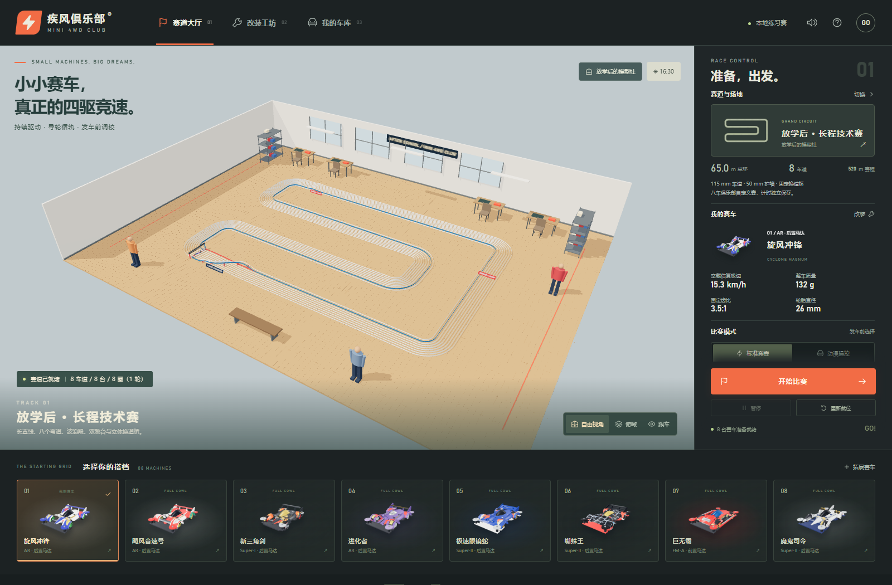
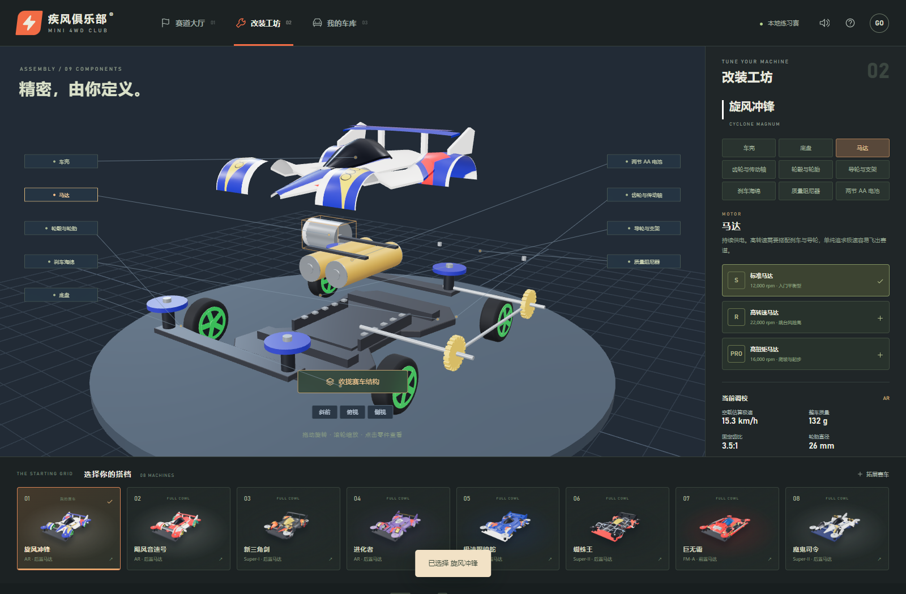

<!-- modelbenchlab-access -->
统一访问：在仓库根目录运行 `npm run dev`，打开 `http://localhost:3000/gpt6-mini4wd-room-racing/`。
独立调试：根目录运行 `npm run dev:one -- gpt6-mini4wd-room-racing`，打开 `http://localhost:3051/`。下文子目录启动说明仅用于独立开发。

# 疾风俱乐部 · MINI 4WD CLUB

桌面迷你四驱车竞赛模拟原型。2026-10-03 根据用户“车型不像、规则偏离、跑道太短”的反馈重新研究并重做车型、赛道与比赛核心。Three.js 固定 0.185.1，WebGL 2 / Vite；独立程序模型和绘制贴图，无运行时 CDN 或后端服务。



## 开始体验

在仓库根目录运行 `npm run dev`，打开 [统一入口](http://localhost:3000/gpt6-mini4wd-room-racing/)。独立调试使用 `npm run dev:one -- gpt6-mini4wd-room-racing`，端口为 3051。新检出仓库先在根目录执行 `npm ci`。

## 重做后的车型与工坊

八款赛车分别对应 Cyclone Magnum、Hurricane Sonic、Neo-Tridagger ZMC、Proto-Saber Evolution、Spin Cobra、Beak Spider、Brocken Gigant 和 Ray Stinger。参考八款田宫官方商品照片，重新区分车壳、轮罩、座舱、尾翼、轮毂与涂装；进化者采用紫色银座舱，极速眼镜蛇采用蓝色蛇背结构，蜘蛛王采用白色轮胎与阶梯尾翼，巨无霸采用前置马达与管架，魔鬼司令纠正为 Ray Stinger。具体依据、Premium 底盘与动画原版差异、单视角推断范围见 [车型核验](docs/car-reference-research.md)。

九类真实部件分组可以展开、拾取、替换：车壳、底盘、马达、固定齿轮与传动轴、轮毂轮胎、导轮支架、刹车海绵、质量阻尼器、两节 AA 电池。工坊提供斜前、俯视、侧视以及拖动观察。界面显示质量、轮径、齿比与空载估算极速，改装存在重量、扭矩、擦墙损失、制动与落地反弹的取舍。



## 比赛与场地

- 三、五车道为常见竞赛规格；八车道是本项目为了八辆同场设置的俱乐部自定义规格，界面明确标注。
- 按实际单位建立 115 mm 车道、50 mm 护墙、约 150 mm 车长与 23 × 17 m 室内房间。
- 三条长赛道为技术折返、高速耐力、双层立交；单环中心线约 65.0、83.5、69.6 m。默认八车道一轮为八圈，每辆依次经过所有车道，总距离约 520–668 m；可以跑一至三轮。
- 导轮被动循轨、马达持续供电、固定齿比。换道由赛道的机械换道桥实现，每圈顺次换一条车道；最外侧桥段升高后跨过其余车道。
- 倒计时后从静止发车，比赛过程中配置锁定。跳台以起跳速度和坡角进入弹道；刹车海绵降低上坡速度，硬低反弹胎和阻尼器降低落地弹跳。
- 离轨、落地串道、过弯倾翻、坡道失速阻塞或电量耗尽会退赛并显示 DNF 原因。所有车辆完赛或退赛后结算，最长十分钟练习赛。
- 三种室内场地：放学后的模型社、模型竞技俱乐部、深夜改装工场。场地改变房间陈设、灯光和环境温度，赛道几何可单独选择。
- 自由环绕、俯瞰、近距离跟车，发车默认切换跟车视角。以桌面键盘鼠标操作为目标，手机不列入验收范围。

标准竞赛遵循实体迷你四驱车的持续驱动原则。用户要求的手动控制保留为独立“动漫操控”练习模式：W / ↑ 供电，S / ↓ 制动；车辆仍循轨和通过机械换道桥。该模式成绩有独立模式标记，没有主动转向、自由变道或冲刺增益。

| 操作 | 输入 |
| --- | --- |
| 动漫模式供电 / 制动 | W / ↑、S / ↓ |
| 发车 / 暂停 / 继续 | 空格 |
| 切换赛道镜头 | C |
| 环绕 / 缩放 | 拖动 / 滚轮 |
| 展开与查看配件 | 工坊结构按钮、部件标签或模型拾取 |
| 安装配件 | 工坊右侧配件选项，赛前或结束后使用 |

## 赛车拓展与保存

支持创建或导入自定义名字、八种基础轮廓与涂装，最多 16 辆拓展赛车；单场人数受车道数与八车上限限制。性能继承基础车型并由九槽配件调校，不能通过导入任意数值制造性能。

```json
{
  "name": "流星冲锋",
  "color": "#e47a36",
  "accent": "#ffe496",
  "shape": "magnum"
}
```

`shape` 为 `magnum/sonic/dagger/evo/cobra/spider/giant/devil`。JSON 不超过 16 KB，名字 1–18 字，颜色需符合 #RRGGBB；未知轮廓回退至旋风冲锋，不执行导入脚本。导出为基础车型定义，配置另存。

本地存档使用 `mini4wd-club-v2`，保留车型、九槽装配、赛道、场地、车道规格、参赛数、轮次与最近 20 场已完赛记录。首次读取旧 v1 时只迁移自定义车型与选车；旧的升级点数、假换道成绩不沿用，旧键保持原样。存储禁用时可以临时练习。

## 验证与诊断

在仓库根目录：

```powershell
npm run test --workspace gpt6-mini4wd-room-racing
npm run build --workspace gpt6-mini4wd-room-racing
npm run sync:check
npm run benchmark:check
# 根开发服务启动后：
node gpt6-mini4wd-room-racing/tests/browser-smoke.mjs
```

单元测试覆盖尺度、三种车道数与完整换道周期、立体换道桥间隙、八车原厂配置完成三条赛道、输入隔离、配件取舍、跳台 DNF 与修正配置完赛、强刹车失速、固定步长一致性与拓展数据校验。

浏览器检查通过隔离的本机 Edge / Playwright 操作真实页面，覆盖八车型与视角、九部件改装保存、标签与连接线、换赛道场地、手动输入、暂停与配置锁定、真实 DNF / 完赛及拓展车型。生产版本也使用同一脚本验证。环境变量为 `BENCH_URL`、`BENCH_QA_LABEL`、`BENCH_PLAYWRIGHT_MODULE`、`BENCH_BROWSER_CHANNEL`；不会读取用户浏览器存档或标签。

当前重做证据为 `docs/redo-source-validation.json`、`docs/redo-production-validation.json` 和 `docs/screenshots/redo-*`；早期非 redo 报告与截图仅代表旧版。只读 `window.mini4wd.snapshot()` 提供车道、状态、速度、距离、退赛原因、渲染统计和模型结构。

## 依据与边界

规则与配件关系参考 [田宫官方竞赛规则](https://www.tamiya.com/english/mini4wd/regulation.htm) 和 [官方调校指南](https://www.tamiya.com/english/mini4wd/setupguide/setupguide.htm)。本项目采用其中与本地练习有关的驾驶、尺度和退赛原则，**不宣称完整官方赛事认证**。

这是经过研究重建的程序化模型，仍非官方模型或三维扫描复刻。七款参考 Premium、三角剑参考原版；隐藏底部结构依据底盘布局推断。经典车型外观仍需要用户视觉验收。

240 Hz 固定步长的简化马达、热量、滚阻、擦墙、坡度与弹道模型；马达转速、扭矩、电池和质量为模拟估值，未使用实测曲线。循轨阶段不是完整刚体接触求解，没有车与车接触、零件脱落、真实空气动力或自由拼装编辑器；飞行落地判定采用简化空间误差。程序及浏览器检查不证明长期帧率、所有设备兼容性或模型完美还原。

2026-10-03 实际核验项目与安装 Three.js 均为 0.185.1，官方最新为 [r186](https://github.com/mrdoob/three.js/releases/tag/r186)。根据用户此前固定 0.185.1 的选择继续使用现有版本，未升级依赖。

## 主要文件

| 文件 | 职责 |
| --- | --- |
| `src/data.js` | 车型、九槽配件、物理参数、赛道与拓展校验 |
| `src/track.js` | 米制直线和圆弧、车道偏移、机械换道桥、跳台与坡度 |
| `src/race.js` | 240 Hz 持续驱动、弹道、退赛、计圈与结算 |
| `src/models.js` | 分车型独立车壳涂装、九结构组、轮组与展开 |
| `src/world.js` | 房间、长赛道、护墙与立交支撑 |
| `src/view.js` | WebGL、镜头、模型拾取与结构展示 |
| `src/main.js` | 页面、模式锁定、键盘、存档与拓展 |
| `tests/`、`docs/` | 测试、官方参考和当前运行证据 |
