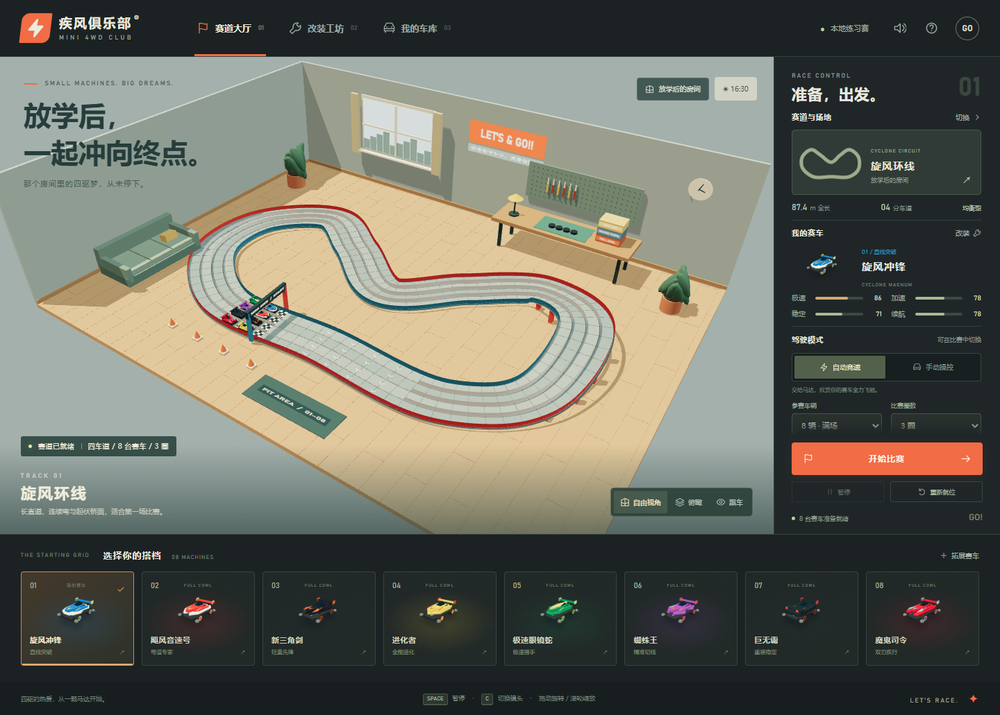
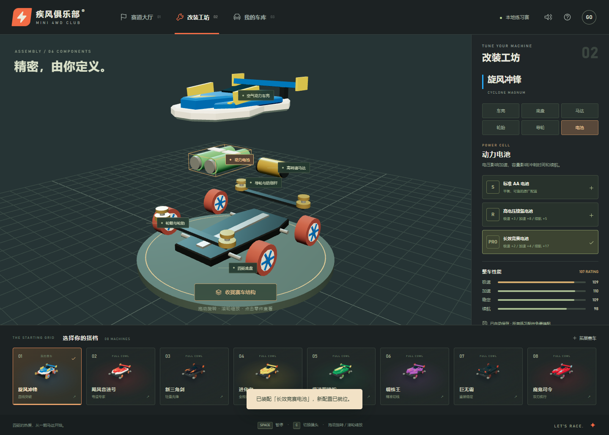

<!-- modelbenchlab-access -->
统一访问：在仓库根目录运行 `npm run dev`，打开 `http://localhost:3000/gpt6-mini4wd-room-racing/`。
独立调试：根目录运行 `npm run dev:one -- gpt6-mini4wd-room-racing`，打开 `http://localhost:3051/`。下文子目录启动说明仅用于独立开发。

# 疾风俱乐部 · MINI 4WD CLUB

房间里的迷你四驱车竞速原型。Three.js 0.185.1 / WebGL 2 / Vite 8，中文界面，全部三维模型与贴图在本地通过代码生成，无 CDN 资源和后端服务。



## 开始体验

在 ModelBenchLab 根目录运行：

```powershell
npm run dev
```

打开 <http://localhost:3000/gpt6-mini4wd-room-racing/>。也可以从 ModelBenchLab 门户中的 **Mini 4WD** 分区进入。

独立启动：

```powershell
npm run dev:one gpt6-mini4wd-room-racing
```

独立调试端口为 **3051**。已安装依赖时不需要再次安装；新检出仓库先在根目录运行 `npm ci`。

## 已实现

- **1–8 台赛车同场**：发车倒计时、1/3/5/9 圈赛制、实时排名、最快单圈、完赛成绩、暂停和重新就位。
- **八辆赛车**：旋风冲锋、飓风音速号、新三角剑、进化者、极速眼镜蛇、蜘蛛王、巨无霸、魔鬼司令。车身轮廓、涂装、尾翼、细节和基础性能各有区别。
- **三种赛道**：旋风环线、闪电高速环、双层交叉挑战。四条可行驶车道；立交在高度上分离，有桥面和桥墩。
- **三种房间场地**：放学后的房间、街角模型俱乐部、午夜车库。灯光、地板、墙面、环境温度和抓地系数随场地变化。
- **改装工坊**：车壳、底盘、马达、轮胎、导轮、电池六类部件，每类三个等级。可展开结构、旋转观察、点击模型或部件标签、直接替换配件。
- **改装影响比赛**：极速、加速、稳定、续航会参与速度、过弯上限、马达发热和电量计算，不只改变 UI。轮胎、马达、导轮、电池和车壳升级也会在模型上体现。
- **手动驾驶**：导轨引导方向，玩家控制油门、制动、冲刺和换道。弯道超速会碰壁减速；冲刺增加耗电和发热，过热及低电量限制动力。
- **镜头**：自由环绕、俯瞰、跟车；以桌面浏览器、键盘鼠标为验收目标。
- **赛车拓展**：创建自定义名称、轮廓、涂装，或导入/导出赛车 JSON。最多 16 台额外车型；单场上限仍为 8 台。
- **本地保存**：当前赛车、六槽配置、场地、赛道、参赛数量、圈数和最近 20 场已完赛玩家成绩写入 `localStorage`。存储被禁用时仍可临时练习。



## 操作

| 操作 | 键盘 / 鼠标 |
| --- | --- |
| 油门 | W / ↑ |
| 刹车 | S / ↓ |
| 左右换道 | A / D，或 ← / → |
| 冲刺 | 按住 Shift，同时按油门 |
| 发车 / 暂停 / 继续 | 空格 |
| 切换镜头 | C |
| 环绕与缩放 | 拖动场景 / 滚轮 |
| 查看部件 | 工坊展开结构后，点模型、标签或右侧部件按钮 |

换道只在起点后的箭头区域开放，旁边需要有空位。自动模式会在这个区域尝试绕过前车。切换到工坊或打开选择弹窗时比赛会暂停；关闭弹窗后可以继续。切换赛车、赛道、场地或装配零件会让赛车重新就位。

## 拓展数据格式

```json
{
  "name": "流星冲锋",
  "color": "#e47a36",
  "accent": "#ffe496",
  "shape": "magnum",
  "stats": [82, 82, 82, 82]
}
```

`stats` 顺序是极速、加速、稳定、续航，单项为 45–95 的整数，总和不超过 340，八种内置车型均可导出再导入。`shape` 可选 `magnum`、`sonic`、`dagger`、`evo`、`cobra`、`spider`、`giant`、`devil`。文件限制 16 KB；未知形状回退至 `magnum`，输入文本通过转义后显示，不能导入可执行脚本。JSON 导出的是基础车型，不包含当前零件配置。

进一步增加车型可以扩展 `src/data.js` 的 `CARS`。模型生成在 `src/models.js`；部件的 `shell/chassis/motor/tires/rollers/battery` 分组接口需保持一致。

## 验证

在 ModelBenchLab 根目录运行：

```powershell
npm run test --workspace gpt6-mini4wd-room-racing
npm run build --workspace gpt6-mini4wd-room-racing
npm run sync:check
# 开发服务启动后，使用本机 Edge 进行真实页面交互测试：
node gpt6-mini4wd-room-racing/tests/browser-smoke.mjs
```

浏览器测试使用仓库当前安装的 Playwright 和本机 Microsoft Edge，在隔离的浏览器上下文中执行，不读取用户浏览器标签和存档。截图保存在 `docs/screenshots/`，结构化结果位于 `docs/browser-validation.json`。可通过 `MINI4WD_URL` 环境变量测试独立端口或生产预览。

`window.mini4wd.snapshot()` 提供只读运行状态、改装、车道、速度、电量、热量和渲染统计，方便复现问题。

## 当前边界

这是可交互、可比赛的风格化原型。经典车名和题材用于四驱兄弟风格的致敬；模型是代码生成的独立几何体，**不是官方高精模型或完整造型复刻**。

采用固定 120 Hz 的导轨竞速规则和简化动力/热量模型，没有刚体求解、真实马达实测曲线、独立悬挂、零件质量分布或真实空气动力仿真。距离和速度属于游戏场景参数，未做实体迷你四驱车的比例和物理标定。赛道提供三套预设布局，没有自由拼装编辑器、联网多人或外部 3D 模型导入。

程序测试与浏览器操作验证可以证明功能闭环；车型还原程度、赛车手感和个人设备上的长期帧率仍需要实际体验验收。按用户后续要求，手机适配不列入交付验收。

## 文件结构

```text
src/data.js       车型、配件、场地、赛道定义和拓展校验
src/track.js      连续四车道采样、坡度、曲率、换道区
src/race.js       固定步长比赛、自动驾驶、手动输入、计圈结算
src/models.js     可拆解赛车、模型分批合并与资源释放
src/world.js      房间、路面、导轨、立交、起点拱门
src/view.js       三维渲染、视角、模型拾取、爆炸结构动画
src/main.js       页面、状态、键盘/触屏、存档、导入导出
src/style.css     桌面和手机布局
tests/           模拟逻辑测试和浏览器交互脚本
docs/            截图、验证记录与接手说明
```

版本检查（2026-09-07）：项目锁定并使用 `three@0.185.1`；当日官方发布页面最新稳定 revision 为 [r185](https://github.com/mrdoob/three.js/releases/tag/r185)，此次没有升级其他项目依赖。API 依据 [Three.js 官方文档](https://threejs.org/docs/)。
